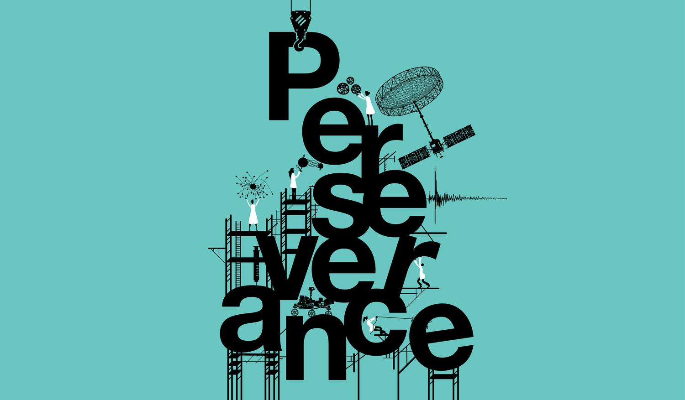
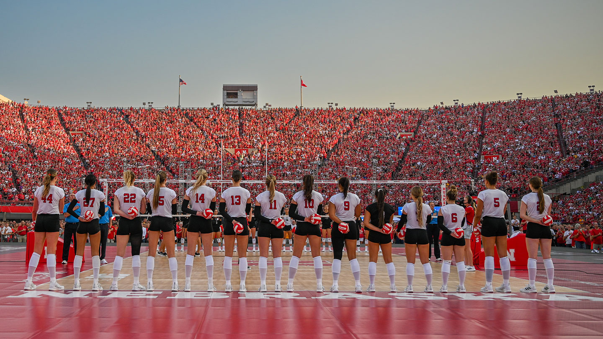
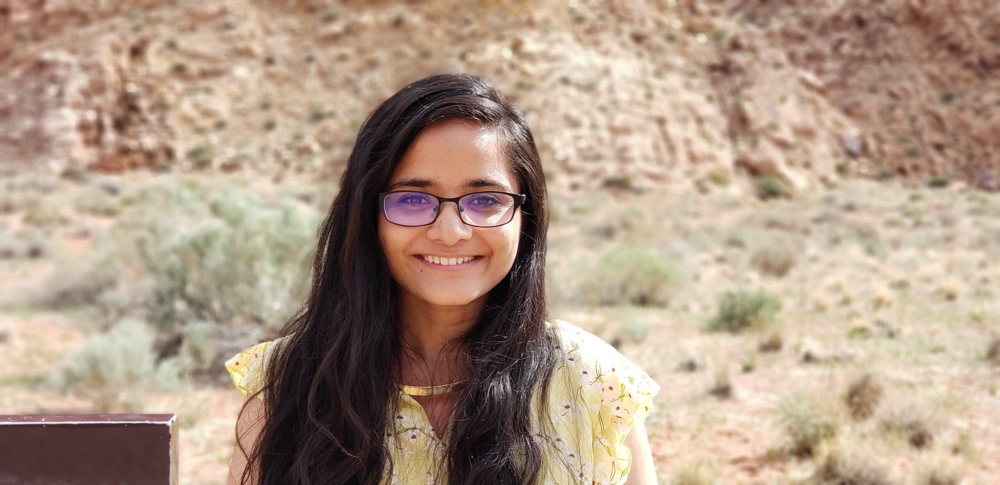

<h2 class="coverage-heading">Press coverage</h2>
<section class="coverage-pins" aria-label="Press coverage">
  <a class="coverage-pin" href="https://www.caltech.edu/about/news/what-makes-us-persist-toward-long-term-goals">Caltech News<strong>What Makes Us Persist Toward Long-Term Goals?</strong></a>
  <a class="coverage-pin" href="https://magazine.caltech.edu/post/perseverance-in-science">Caltech Magazine<strong>Where Perseverance Meets Discovery</strong></a>
  <a class="coverage-pin" href="https://www.snexplores.org/article/how-to-set-achieve-goals">Science News Explores<strong>Big Goals Can Feel Overwhelming. Here’s How to Stay on Track</strong></a>
  <a class="coverage-pin" href="https://pasadenaconservatory.org/blog/2025/05/sneha-aenugu/">Pasadena Conservatory of Music<strong>Sneha Aenugu: Music, Neuroscience, and Learning</strong></a>
</section>
