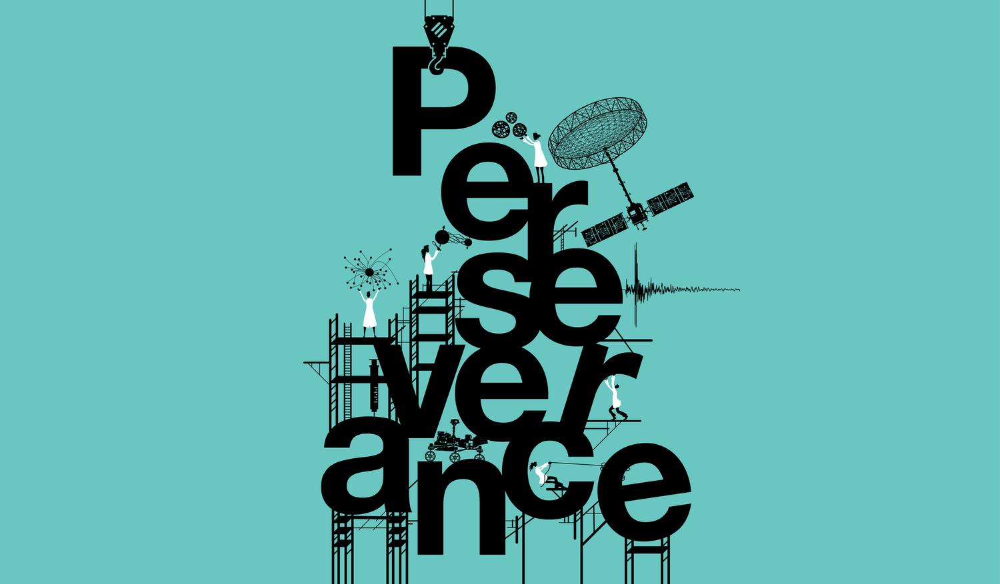

<section class="outreach-videos" aria-label="Public talks and outreach videos">
  <a class="video-card" href="https://www.youtube.com/watch?v=sZ9mOUQYgkU">▶Thesis Defense<strong>Building Agency: Towards a Mechanistic Understanding of Human Autonomous Goal Pursuit (Thesis Defense)</strong></a>
  <a class="video-card" href="https://www.youtube.com/watch?v=5uFFyZxUJNA&amp;t=2812s">▶Public Talk<strong>What Games Teach Us About Human and Artificial Intelligence</strong></a>
  <a class="video-card" href="https://www.youtube.com/watch?v=DnSWZIZVQKY&amp;t=3s">▶3 Minute Thesis · 2025<strong>An Architect for Goals</strong></a>
  <a class="video-card" href="https://www.youtube.com/watch?v=oD9T16K3FFs">▶3 Minute Thesis · 2023<strong>Using Games to Probe the Mind</strong></a>
</section>

<section class="coverage-section" aria-labelledby="coverage-heading">
  <h2 id="coverage-heading">Magazine coverage</h2>
  

    <a class="coverage-pin" href="https://www.caltech.edu/about/news/what-makes-us-persist-toward-long-term-goals">Caltech News<strong>What Makes Us Persist Toward Long-Term Goals?</strong></a>
    <a class="coverage-pin" href="https://magazine.caltech.edu/post/perseverance-in-science">Caltech Magazine<strong>Where Perseverance Meets Discovery</strong></a>
    <a class="coverage-pin" href="https://www.snexplores.org/article/how-to-set-achieve-goals">Science News Explores<strong>Big Goals Can Feel Overwhelming. Here’s How to Stay on Track</strong></a>
    <a class="coverage-pin" href="https://pasadenaconservatory.org/blog/2025/05/sneha-aenugu/">Pasadena Conservatory of Music<strong>Sneha Aenugu: Music, Neuroscience, and Learning</strong></a>
  

</section>
